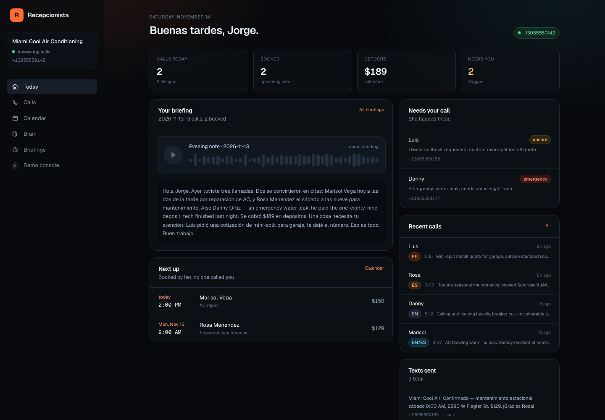
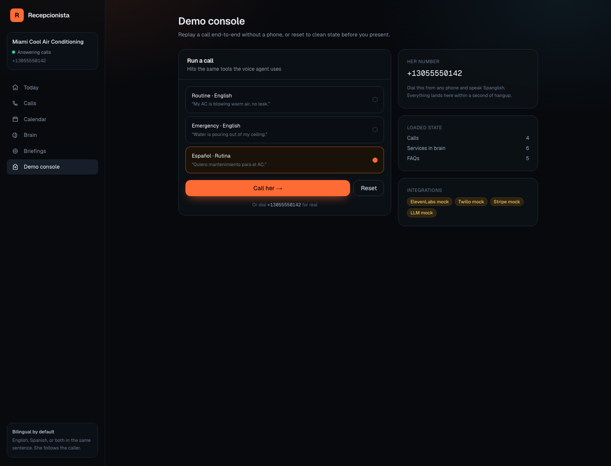
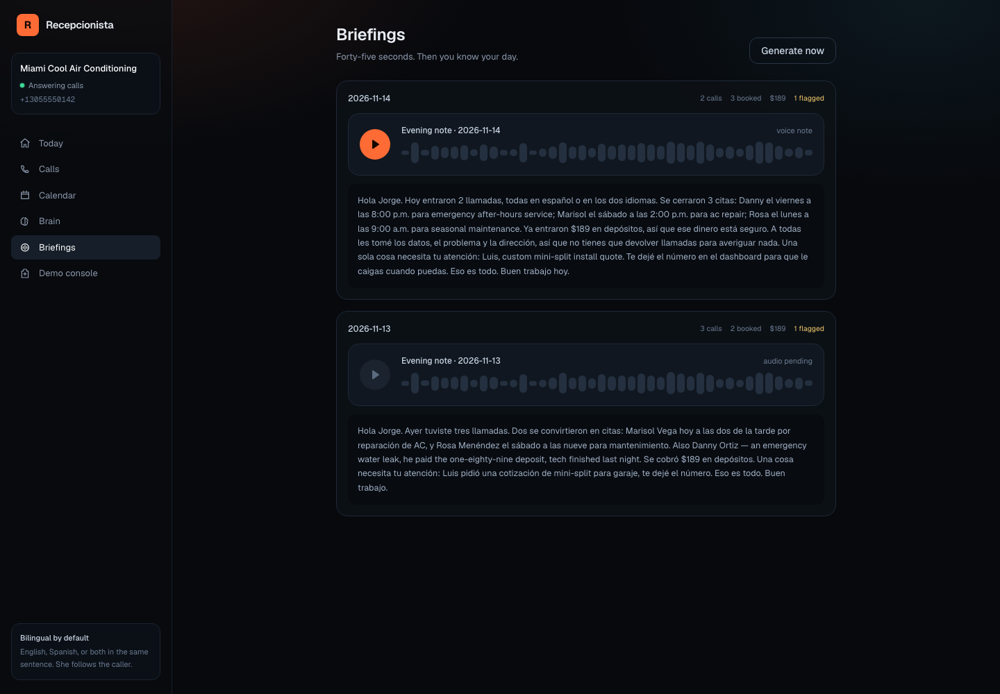

# Recepcionista

**Paste your website. In two minutes you have a bilingual employee who answers,
books, gets paid, and tells you about your day.**

Built at **Buildersgiving · Miami AI Hackathon**, with Mel driving six parallel
agent workstreams.

An AI front-desk employee for Miami home-service small businesses. She answers
the phone in English, Spanish, or both in the same sentence; triages
emergencies; books the job; texts the customer a confirmation; collects an
emergency deposit by payment link; and calls the owner at the end of the day
with a 45-second voice note.

**[Read the PRD →](PRD.md)** — problem framing, data model, agent design and the
parallel work plan.

## Screenshots

Onboarding — paste a website URL, get a knowledge base, a voice agent and a
phone number:


Dashboard — calls, bookings and today's revenue at a glance:



The demo console — drives the same seven HTTP tools the voice agent calls on a
real call:



Call log and transcripts, including the generated end-of-day briefing:



The emergency deposit page the customer receives by SMS:


Landing page:


---

## Quick start

```sh
export PATH="/opt/homebrew/bin:$HOME/.bun/bin:$PATH"
bun install
cp .env.example .env.local     # optional: add keys to go live

docker compose -f compose.dev.yaml up -d   # Postgres 17 on localhost:5433
bunx prisma migrate deploy     # create the tables
bun scripts/seed.ts            # demo business: Miami Cool Air Conditioning

bun dev                        # http://localhost:3000
```

**Requirements:** Node/Bun, Docker. Nothing is installed system-wide — Postgres
runs in a
container and its data lives in a named volume, so
`docker compose -f compose.dev.yaml down`
stops it without losing anything and `… down -v` throws it away.

| Command | Does |
| --- | --- |
| `bun run db:up` / `db:down` | start / stop Postgres (`compose.dev.yaml`) |
| `bun run db:migrate` | create a migration from `prisma/schema.prisma` |
| `bun run db:seed` | reload the demo dataset |
| `bun run db:reset` | drop, re-migrate, reseed |
| `bun run db:studio` | browse the data at `localhost:5555` |

Adding a key flips a service from mock to live with no code change.

### Deploying it

`compose.production.yaml` is a self-contained stack (app + Postgres + one-shot
migrations)
designed for a server that already runs Traefik. See [DEPLOY.md](DEPLOY.md); the
short version:

```sh
cp .env.example .env    # set DOMAIN, APP_URL, POSTGRES_PASSWORD, provider keys
./deploy.sh             # build, migrate, start
./deploy.sh --seed      # …plus the demo dataset
```

Verify it:

```sh
bun scripts/smoke.ts     # 39 assertions, drives the whole product over HTTP
bun scripts/ws1-test.ts  # 14 — extraction, KB, provisioning
bun scripts/ws3-test.ts  # 40 — the seven voice tools
bun scripts/ws4-test.ts  # 71 — bilingual SMS, payments, webhooks
bun scripts/ws5-test.ts  # 17 — briefings, TTS, gratitude
```

No keys are required to demo. Every external service runs through an adapter
with a local fallback:

| Service | With a key | Without a key |
| --- | --- | --- |
| LLM (OpenAI / Anthropic) | real extraction + summaries | deterministic templates, still coherent |
| ElevenLabs | real voice agent + TTS briefings | macOS `say` + `afconvert` for briefings; scripted call replay |
| Twilio | real SMS + number provisioning | SMS logged and shown in the dashboard |
| Stripe | real test-mode payment links | `/pay/[id]` mock checkout page |

---

## Demo path (3 minutes)

1. `/onboarding` → paste `miamicoolair.com` → watch extraction → review → **Go
   live** → get a number
2. `/dashboard/demo` → **Call her** (Español · Rutina) → booking + confirmation
   SMS appear
3. `/dashboard/demo` → **Emergency · English** → deposit link appears
4. `/dashboard/briefings` → **Generate now** → play the voice note
5. `/dashboard` → the day, summarized

---

## Architecture

```text
Next.js 16 (App Router) ── Postgres 17 (Docker) via Prisma
        │
        ├── /api/businesses/[id]/provision   ← URL → KB → system prompt → phone
        ├── /api/voice/tools/[tool]          ← what ElevenLabs calls mid-conversation
        ├── /api/sms/*  /api/payments/*      ← Twilio + Stripe
        └── /api/briefings/*                 ← summary → ElevenLabs TTS → audio
```

**Key design choice:** the voice agent never touches the database. It calls
seven HTTP tools
(`check_availability`, `create_booking`, `send_sms`, `create_payment_link`,
`flag_emergency`,
`get_pricing`, `handoff_to_human`), each returning a `message` the agent speaks
aloud. The demo
console drives those exact same endpoints, so what judges see is the real
pipeline.

## The seven tools

| Tool | Does | Guardrail |
| --- | --- | --- |
| `check_availability` | next open slots from business hours + existing bookings | never offers a taken slot |
| `create_booking` | writes the appointment, fires the confirmation SMS | validates hours + conflicts first |
| `send_sms` | arbitrary text to the caller | logged |
| `create_payment_link` | Stripe link for an emergency deposit | hard cap $500 |
| `flag_emergency` | marks the call, alerts the owner | urgent calls never get buried |
| `get_pricing` | looks up a starting price | returns `matched:false` rather than inventing one |
| `handoff_to_human` | flags for owner callback | the agent admits what she doesn't know |

## Layout

```text
src/lib/types.ts          every domain type (frozen contract)
src/lib/db/               Prisma client + async data layer (single import point)
src/lib/providers/        llm · twilio · stripe — real-or-mock adapters
src/lib/voice/            the seven tools + ElevenLabs agent client
src/lib/briefing/         Spanglish script generation + TTS
src/lib/messaging/        bilingual SMS templates
src/app/api/              all route handlers
src/app/dashboard/        owner UI
scripts/seed.ts           demo data
CONTRACTS.md              the interface contract six agents built against
```

## How Mel was used

Six workstreams ran in parallel against a frozen interface contract
(`CONTRACTS.md`), each owning
disjoint files: schema/API, extraction/KB, dashboard, voice tools, SMS/payments,
briefings/gratitude.
See `MEL_USAGE.md`.

## What is real vs mocked

| Piece | Status |
| --- | --- |
| Booking, call records, knowledge base, briefing scripts | **Real** — written to the store, read by every page |
| Briefing audio | **Real audio** — ElevenLabs with a key, macOS `say` (Paulina, es_MX) without one |
| SMS copy and delivery | Real bilingual copy; delivered through Twilio with a key, logged to the dashboard without one |
| Deposit links | Real Stripe test-mode links with a key; local `/pay/[id]` checkout without one |
| Voice agent | Real ElevenLabs Conversational AI agent with a key; scripted replay without one |
| Calendar | Intentionally internal — no OAuth, no external sync |

## Notes

- Calendar is internal by design — no OAuth, no external sync.
- Stripe stays in test mode. No card data touches this app.
- **Postgres is the source of truth.** It runs in Docker
  (`docker compose up -d`), reachable at
  `localhost:5433`. `POST /api/demo/reset` reseeds it in-process without leaving
the browser.
- Schema is in `prisma/schema.prisma`; migrations are checked in under
  `prisma/migrations/`.
- Every function in `src/lib/db/` is async and returns plain domain objects from
  `@/lib/types` —
  no caller ever imports a Prisma type.
