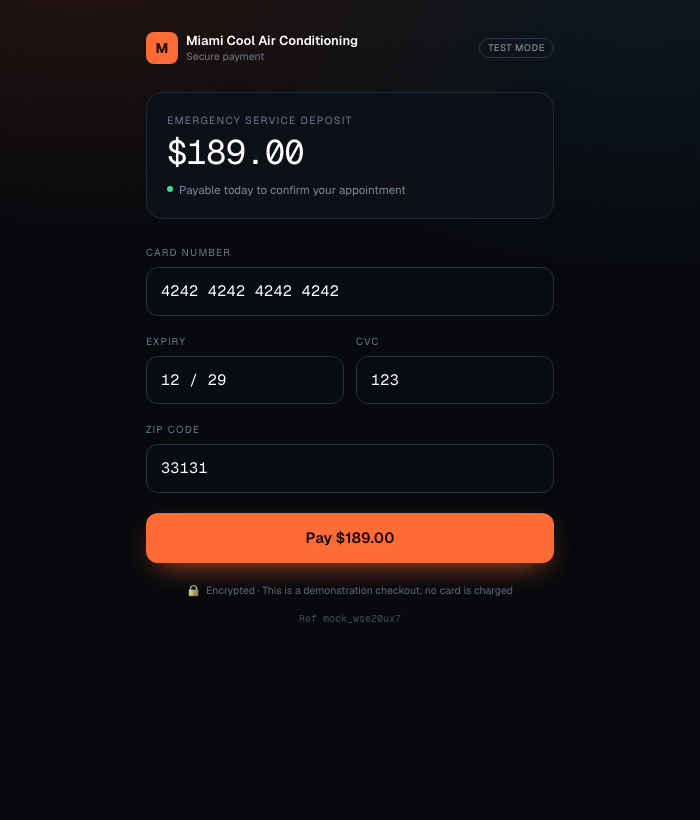
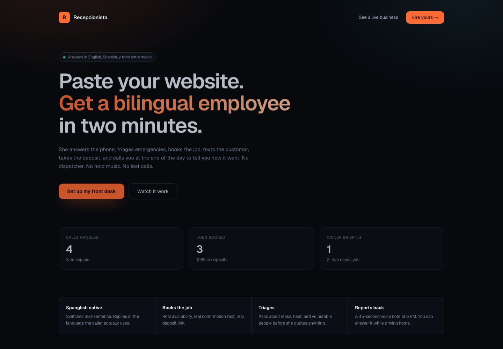

# Recepcionista

**Paste your website. In two minutes you have a bilingual employee who answers,
books, gets paid, and tells you about your day.**

Built at **Buildersgiving · Miami AI Hackathon**, with Mel driving six parallel
agent workstreams.

An AI front-desk employee for Miami home-service small businesses. She answers
the phone in English, Spanish, or both in the same sentence; triages
emergencies; books the job; texts the customer a confirmation; collects an
emergency deposit by payment link; and calls the owner at the end of the day
with a 45-second voice note.

**[Read the PRD →](PRD.md)** — problem framing, data model, agent design and the
parallel work plan.

## Documentation index

| Doc | What it covers |
| --- | --- |
| [docs/auth.md](docs/auth.md) | principals, roles, sessions, signup/verify/reset/invite flows, 2FA, CSRF, threat notes |
| [docs/billing.md](docs/billing.md) | Stripe subscriptions, trials, plan caps, grandfathering, releasing canceled tenants |
| [docs/compliance.md](docs/compliance.md) | recording/AI disclosure, SMS consent and opt-out, retention and erasure, operator duties |
| [docs/env-vars.md](docs/env-vars.md) | every environment variable: required, default, secret |
| [docs/design/admin-console-architecture.md](docs/design/admin-console-architecture.md) | the platform admin console: owner decisions, the settings registry (`src/lib/config`), precedence env pin > console > default, tiers, the runtime config module, the phase plan |
| [docs/design/admin-console-contracts.md](docs/design/admin-console-contracts.md) | the admin console backend (Phases 2, 4, 5, 7, 8): tables, helpers, every `/api/admin/*` route with its permission, role matrix, semantic rules (tiers, secrets, rotation, freeze, break-glass), error codes, what the Phase 3 UI can rely on, residuals |
| `/admin` UI (agent A) | the console shell, the settings pages generated from the registry, history / rollback / import-export, system, overview, "Move to console", the legal page editor and the public `/terms` `/privacy` `/sms-terms`, banners and maintenance mode: see the **Agent A** section of [docs/design/admin-console-contracts.md](docs/design/admin-console-contracts.md) and the runbook section "Platform console" |
| [docs/runbook.md](docs/runbook.md) | pre-deploy checklist, live test call, `verify:deploy`, rollback, provider checklist, release of canceled tenants |
| [docs/security-headers.md](docs/security-headers.md) | nonce-based CSP, other response headers, rollout switches |
| [docs/testing.md](docs/testing.md) | what runs where, the scratch database, destructive scripts |
| [docs/dependencies.md](docs/dependencies.md) | dependency audit, licenses, advisories, pins |
| [docs/integrations/google-calendar.md](docs/integrations/google-calendar.md) | Google Calendar two-way sync: setup, data stored, busy blocks, `block_on_busy`, troubleshooting |
| [docs/owner-call-in.md](docs/owner-call-in.md) | the owner updates the AI by phone: hours, closed dates, service area, services, FAQs; SMS confirmation and undo. Also the voice reply: hear who called and have a customer texted back after an SMS YES code |
| [docs/verticals.md](docs/verticals.md) | trade packs (HVAC, plumbing, electrical, cleaning, landscaping, dental, general): prompt, emergencies, seeds, SMS wording; choosing and changing the vertical |
| [docs/i18n.md](docs/i18n.md) | English / Spanish: message catalogs, language resolution, switcher, localized emails and texts, residual English |
| [docs/refunds.md](docs/refunds.md) | cancellation, deposit refunds by policy, Stripe refund/dispute events, the `C` text reply |
| [docs/changelog-hardening.md](docs/changelog-hardening.md) | review findings and their resolution; the "Phase: features" section maps each feature to code and tests |
| [docs/known-limitations.md](docs/known-limitations.md) | honest list of what is not covered or needs the operator |

See also [DEPLOY.md](DEPLOY.md).

## Screenshots

Onboarding — paste a website URL, get a knowledge base, a voice agent and a
phone number:


Dashboard — today's calls, upcoming bookings and this month's deposits at a glance:


The demo console (local `DEMO_MODE=true` only; it does not exist in production) —
runs the same tool code the voice agent calls on a real call, in-process:


Call log and transcripts, including the generated end-of-day briefing:


The emergency deposit page the customer receives by SMS:



Landing page:



---

## Quick start

```sh
export PATH="/opt/homebrew/bin:$HOME/.bun/bin:$PATH"
bun install
cp .env.example .env           # Prisma and Next read .env, not .env.local

docker compose -f compose.dev.yaml up -d   # Postgres 17 on localhost:5433
bunx prisma migrate deploy     # create the tables (uses DATABASE_URL from .env)
bun scripts/seed.ts            # demo business: Miami Cool Air Conditioning

bun dev                        # http://localhost:3000  (set ADMIN_TOKEN, or ALLOW_INSECURE_DEV=true for local-only no-auth dev)
```

The `DATABASE_URL` line in `.env.example` already matches `compose.dev.yaml` (database `recepcionista_dev`).

**Renaming the dev database (one time, existing local volumes only).** `POSTGRES_DB` only applies when the
volume is first created, so a volume from before the rename still has a database named `recepcionista`, which
`db:seed` refuses. Either rename it in place:

```bash
docker compose -f compose.dev.yaml up -d
docker exec recepcionista-db psql -U recepcionista -d postgres \
  -c 'ALTER DATABASE recepcionista RENAME TO recepcionista_dev;'
```

(close any open connections first, e.g. stop `bun dev`), or throw the data away with
`docker compose -f compose.dev.yaml down -v && bun run db:up` and reseed. Then update `DATABASE_URL` in your
`.env` to end in `/recepcionista_dev?schema=public`.
Add provider keys to `.env` to go live; leave them blank to keep the mocks.

**Requirements:** Node/Bun, Docker. Nothing is installed system-wide — Postgres
runs in a
container and its data lives in a named volume, so
`docker compose -f compose.dev.yaml down`
stops it without losing anything and `… down -v` throws it away.

| Command | Does |
| --- | --- |
| `bun run db:up` / `db:down` | start / stop Postgres (`compose.dev.yaml`) |
| `bun run db:migrate` | create a migration from `prisma/schema.prisma` |
| `bun run db:seed` | reload the demo dataset |
| `bun run db:reset` | drop, re-migrate, reseed |
| `bun run db:studio` | browse the data at `localhost:5555` |

Adding a key flips a service from mock to live with no code change.

### Deploying it

`compose.production.yaml` is a self-contained stack (app + Postgres + one-shot
migrations)
designed for a server that already runs Traefik. See [DEPLOY.md](DEPLOY.md); the
short version:

```sh
cp .env.example .env    # set DOMAIN, APP_URL, POSTGRES_PASSWORD, ADMIN_TOKEN, APP_SECRET_KEY,
                        # EMAIL_PROVIDER + EMAIL_FROM + its key, STRIPE_WEBHOOK_SECRET, provider keys
                        # (every variable: docs/env-vars.md; deploy.sh refuses to run without the required ones)
./deploy.sh             # build, back up the DB, migrate, start
```

## Authentication

The owner dashboard and the JSON API are protected by one shared secret,
`ADMIN_TOKEN`.

- **Dashboard:** open `/login` and sign in with the token.
- **API:** send the token as a bearer header:
  `curl -H "Authorization: Bearer $ADMIN_TOKEN" https://<DOMAIN>/api/businesses`
- **Generate a token:** `openssl rand -hex 32`. Put it in `.env` and never
  commit it.
- **Provider callbacks are not bearer-authenticated.** Twilio, ElevenLabs and
  Stripe calls are verified with their own signatures (`ELEVENLABS_WEBHOOK_SECRET`,
  `STRIPE_WEBHOOK_SECRET`), not with `ADMIN_TOKEN`.

`deploy.sh` refuses to deploy without `ADMIN_TOKEN` and `STRIPE_WEBHOOK_SECRET`,
and, when `ELEVENLABS_API_KEY` is set, without `ELEVENLABS_TOOL_SECRET` and
`ELEVENLABS_WEBHOOK_SECRET` (or `TWILIO_AUTH_TOKEN` when `TWILIO_ACCOUNT_SID` is set).
Set `ADMIN_TOKEN` locally too, so you test the same sign-in path you deploy.

**Nothing fails open because of `NODE_ENV`.** If a webhook or tool secret is unset the app
rejects the request (Twilio signature, ElevenLabs webhook signature, tool secret). To run
locally without secrets, opt in explicitly with `ALLOW_INSECURE_DEV=true` (ignored in
production builds). Never combine it with a tunnel or any publicly reachable host.
**Missing provider keys also fail honestly in production**: without a complete Twilio
configuration a text is a failure (`sms_provider_not_configured`: the verification routes answer
503, nothing is counted against the plan, no follow-up consent is recorded), never a "mock"
success; `DEMO_MODE` is ignored in production (reset, simulated calls and the mock checkout are
404). Without `ELEVENLABS_API_KEY` there is no voice agent (see the table below).

**ElevenLabs webhook secret.** The first provision creates the post-call
webhook. When an **owner admin** (an individual account with the owner platform role) provisions,
the signing secret goes straight into the encrypted console store (`elevenlabs.webhook_secret`,
critical tier, audited, every admin mailed) and the response says `webhook_secret_stored: true`.
In every other case (the break-glass Bearer token, `ELEVENLABS_WEBHOOK_SECRET` pinned in the
environment, a frozen console, no console storage) the old behaviour applies: the secret is shown once in the
admin-only provision response (`webhook_secret`), the app does not store or log it, and you copy it to
`ELEVENLABS_WEBHOOK_SECRET` in `.env` and redeploy. If you lose it, delete the
webhook in the ElevenLabs workspace and re-provision. Providers, secrets, connection tests and the
`APP_SECRET_KEY` rotation are managed at `/admin/providers`.

**Login throttling.** `X-Forwarded-For` is trusted only with `TRUSTED_PROXY=true`
(set it only behind Traefik; behind a CDN *and* Traefik also set `TRUSTED_PROXY_HOPS=2` so the key is
the client, not the CDN). Login is limited per client IP (attempts) and per (account, client IP)
with an exponential backoff on failures only: one address guessing at an account never locks that
account out for anyone else, and anonymous junk traffic only exhausts its own address. Without a trusted
proxy all clients share one key, so the thresholds are far looser.

**Data retention is opt-in.** Set `RETENTION_JOB=on` only after reviewing each business's retention window;
until then nothing is auto-deleted and boot logs what a purge would remove. Inspect with
`POST /api/admin/retention {"dry_run":true}`. Twilio's inbound-SMS webhook must be `POST /api/sms/inbound`
(see DEPLOY.md and `docs/compliance.md`).

**Background jobs run by themselves in production.** A small runner inside the app (Postgres leases, safe with several instances) generates each
live business's end-of-day briefing at 18:00 in that business's own time zone (and texts the verified owner a link), runs the gratitude sweep hourly
and cleans expired sessions/tokens/events. `JOBS=on|off` (default on in production, off in development), `JOBS_TICK_SECONDS` (default 60).
`GET /api/admin/jobs` shows last run / next due; `POST /api/admin/jobs/run` runs one by hand (dry run by default). See `docs/runbook.md` "Background jobs".

**Phone numbers never fake it in production.** If the carrier purchase fails, provisioning answers 502 (503 without Twilio credentials) and the business
stays `onboarding`; a retry reuses a number that was already bought. The `+1<area>555xxxx` demo number exists only outside production with no Twilio credentials.

**Texts are metered in SMS segments** (an emoji or accented character makes each segment shorter), a text that would exceed the cap is not sent, and trials get lower caps
(`TRIAL_SMS_CAP` 50, `TRIAL_CALL_MINUTES_CAP` 30). See `docs/billing.md`.

## Security checklist before going live

Work through this before pointing a real phone number or a real Stripe account
at a public host. Each item is a check, not a promise that the code does it.

- [ ] `ADMIN_TOKEN` is set to a fresh `openssl rand -hex 32` value, and it is not
      reused from any other system.
- [ ] `STRIPE_WEBHOOK_SECRET` is set, and `STRIPE_ALLOW_UNSIGNED` is unset.
- [ ] `ELEVENLABS_WEBHOOK_SECRET` is set. Unsigned voice webhook calls are rejected.
- [ ] `DEMO_MODE` is unset. `POST /api/demo/reset` is not reachable from the internet.
- [ ] `APP_SECRET_KEY` (32 random bytes, base64) and a real `EMAIL_PROVIDER` (`resend`/`smtp`) are set: signup verification,
      password reset and 2FA depend on them. `BILLING_ENFORCED` is set explicitly (production fails closed: unset = enforced, and
      deploy.sh refuses it unset); with `true`: `STRIPE_PRICE_ID`, `STRIPE_BILLING_WEBHOOK_SECRET`, and existing tenants comped first
      (`bun scripts/grandfather-existing.ts --before <deploy time>`, docs/billing.md). `OWNER_PHONE_GRANDFATHER` stays off.
- [ ] Open signup has a captcha: `TURNSTILE_SECRET_KEY` + `NEXT_PUBLIC_TURNSTILE_SITE_KEY` set (or the explicit, not recommended
      `SIGNUP_ALLOW_WITHOUT_CAPTCHA=true`). Without either, production refuses public signup (503 `signup_disabled`, `/signup` is invite-only) and deploy.sh fails.
- [ ] Pages carry a nonce-based `Content-Security-Policy` (docs/security-headers.md); `bun run verify:deploy` passes.
- [ ] Without a token, `/dashboard`, `/api/businesses` and `/api/sms/send` return
      401. Check this with `curl` against the public URL.
- [ ] `STRIPE_SECRET_KEY` is a test key (`sk_test_…`) until the payment flow has
      been reviewed, and the demo checkout at `/pay/[id]` (DEMO_MODE only, never rendered in
      production) is not the path used for live deposits.
- [ ] Postgres has no published port. `docker compose -f compose.production.yaml ps`
      shows no host mapping for `db`.
- [ ] Traefik has a rate limit, and `/api/demo` and `/api/voice/tools` are
      restricted to provider IPs or blocked from the internet.
- [ ] A pre-deploy backup exists in `backups/`, and you have tested a restore.
- [ ] Callers are told the call is recorded and that the assistant is an AI. Florida
      requires all-party consent for recording. Get counsel review.
- [ ] Texts include an opt-out (STOP) path, and A2P/10DLC registration is complete.
      `SMS_ALLOWED_COUNTRY_CODES` lists only the countries you serve.
- [ ] Gas-smell and carbon-monoxide calls are told to leave the building and call
      911 before any booking is taken.
- [ ] Any `.env` or key that was pasted into chat, a ticket or a screenshot is
      rotated.

Verify it:

```sh
bun scripts/smoke.ts     # 39 assertions, drives the whole product over HTTP
bun scripts/ws1-test.ts  # 14 — extraction, KB, provisioning
bun scripts/ws3-test.ts  # 40 — the core voice tools
bun scripts/ws4-test.ts  # 71 — bilingual SMS, payments, webhooks
bun scripts/ws5-test.ts  # 17 — briefings, TTS, gratitude
```

No keys are required to try it locally (development, or `DEMO_MODE=true`). Every
external service runs through an adapter with a local fallback, **and every fallback is
refused in production**:

| Service | With a key | Without a key (development / demo only) |
| --- | --- | --- |
| LLM (OpenAI / Anthropic) | real extraction + summaries | call summaries and briefings use deterministic templates; website-to-knowledge-base extraction **refuses** (422), it never invents a knowledge base |
| ElevenLabs | real voice agent + TTS briefings | no local voice: briefings simply have no audio without an ElevenLabs key (the dashboard says "audio unavailable"); a mock agent id and scripted call replay (`DEMO_MODE`) |
| Twilio | real SMS + number provisioning | SMS logged (a mock) and shown in the dashboard; fake `+1<area>555xxxx` numbers. In production: texts fail with `sms_provider_not_configured`, number purchase is refused |
| Stripe | real test-mode payment links | `/pay/[id]` mock checkout page. A Stripe error with a real key is an error (the mock only with `DEMO_MODE=true`) |

---

## Demo path (3 minutes)

1. `/onboarding` → paste `miamicoolair.com` → watch extraction → review → **Go
   live** → get a number
2. `/dashboard/demo` → **Call her** (Español · Rutina) → booking + confirmation
   SMS appear
3. `/dashboard/demo` → **Emergency · English** → deposit link appears
4. `/dashboard/briefings` → **Generate now** → play the voice note
5. `/dashboard` → the day, summarized

---

## Architecture

```text
Next.js 16 (App Router) ── Postgres 17 (Docker) via Prisma
        │
        ├── /api/businesses/[id]/provision   ← URL → KB → system prompt → phone
        ├── /api/voice/tools/[tool]          ← what ElevenLabs calls mid-conversation
        ├── /api/sms/*  /api/payments/*      ← Twilio + Stripe
        └── /api/briefings/*                 ← summary → ElevenLabs TTS → audio
```

**Key design choice:** the voice agent never touches the database. It calls
HTTP tools (the seven below, plus `reschedule_booking`, `cancel_booking`,
`transfer_to_human` when `NATIVE_TRANSFER=on`, and the owner call-in tools),
each returning a `message` the agent speaks aloud. The demo console (local only)
runs the same tool code in-process.

## The core tools

| Tool | Does | Guardrail |
| --- | --- | --- |
| `check_availability` | next open slots from business hours + existing bookings | never offers a taken slot |
| `create_booking` | writes the appointment, fires the confirmation SMS | validates hours + conflicts first |
| `send_sms` | arbitrary text to the caller | logged |
| `create_payment_link` | Stripe link for an emergency deposit | hard cap $500 |
| `flag_emergency` | marks the call, alerts the owner | urgent calls never get buried |
| `get_pricing` | looks up a starting price | returns `matched:false` rather than inventing one |
| `handoff_to_human` | flags for owner callback | the agent admits what she doesn't know |

## Layout

```text
src/lib/types.ts          every domain type (frozen contract)
src/lib/db/               Prisma client + async data layer (single import point)
src/lib/providers/        llm · twilio · stripe — real-or-mock adapters
src/lib/voice/            the voice tools + ElevenLabs agent client
src/lib/briefing/         Spanglish script generation + TTS
src/lib/jobs/             background job runner: 6 PM briefing per time zone, gratitude sweep, cleanup, retention
src/lib/messaging/        bilingual SMS templates
src/app/api/              all route handlers
src/app/dashboard/        owner UI
scripts/seed.ts           demo data
CONTRACTS.md              the interface contract six agents built against
```

## Logs

Every meaningful step is logged as one line through `src/lib/log.ts` — a
dependency-free structured logger — plus `src/instrumentation.ts`, which prints
the boot configuration and catches server errors that routes never see.

```text
2026-11-15T14:02:11.418Z  info   provision     number.assigned   business=… phone=+13055557879 mock=true
2026-11-15T14:02:16.902Z  info   elevenlabs    agent.created     agent=agent_9401… business=… ms=4981
2026-11-15T14:02:16.980Z  info   elevenlabs    phone.bound       phone_number_id=phnum_7301… agent=agent_9401…
2026-11-15T14:02:16.983Z  info   provision     done              business=… phone_mock=true agent_mock=false ms=5031
```

| Field | Meaning |
| --- | --- |
| `scope` | where the event happened — `db`, `llm`, `twilio`, `sms`, `tts`, `provision`, `voice-tools`, `http`, … |
| `event` | what happened, dotted: `business.created`, `agent.create_failed`, `sweep.done` |
| `key=value` | structured context; strings with spaces are quoted, secrets are `«redacted»` |
| `ms` | set on anything that crossed a network or a transaction |

- Set `LOG_LEVEL=debug|info|warn|error` to change the verbosity. Default is
  `debug` outside production and `info` inside it.
- `[sms:mock]` lines still print the full message body — that is what the demo
  console shows when no Twilio key is configured.
- Nothing sensitive is logged: provider keys, tokens and `authorization` headers
  are redacted by key name, and `DATABASE_URL` is reduced to
  `host:port/database`.
- In development Next also prints one line per request and forwards browser
  `warn`/`error` to the terminal (`logging` in `next.config.ts`).

```bash
LOG_LEVEL=debug bun dev                        # everything, including LLM/DB timing
# Example only: a personal systemd user unit, not part of this repo. Replace
# the unit name with your own, or just watch the `bun dev` terminal.
journalctl --user -u recepcionista-dev -f      # live trail
journalctl --user -u recepcionista-dev | grep ' agent\.'  # every agent create/update
```

## How Mel was used

Six workstreams ran in parallel against a frozen interface contract
(`CONTRACTS.md`), each owning
disjoint files: schema/API, extraction/KB, dashboard, voice tools, SMS/payments,
briefings/gratitude.
See `MEL_USAGE.md`.

## What is real vs mocked

| Piece | Status |
| --- | --- |
| Booking, call records, knowledge base, briefing scripts | **Real** — written to the store, read by every page |
| Briefing audio | **Real audio** — ElevenLabs with a key. Without one only a development Mac can produce audio (`say`, es_MX); elsewhere there is no audio (text only) |
| SMS copy and delivery | Real bilingual copy; delivered through Twilio with a key. Without one: logged only outside production; in production a text FAILS (`sms_provider_not_configured`) |
| Deposit links | Real Stripe test-mode links with a key; local `/pay/[id]` demo checkout without one (non-production only; production refuses to create a link without a key) |
| Voice agent | Real ElevenLabs Conversational AI agent with a key; scripted replay (`DEMO_MODE`) without one. No agent speaks (and no recording consent is claimed) in production without the key |
| Calendar | Internal calendar, with an optional two-way Google Calendar sync (OAuth; `docs/integrations/google-calendar.md`) |

## Notes

- The calendar is internal; Google Calendar sync is optional (`docs/integrations/google-calendar.md`).
- Stripe stays in test mode here. Real card entry happens on Stripe's pages (production deposit links are `buy.stripe.com`); the app's own `/pay/[id]` page forwards a booking with a live link to Stripe, shows a receipt once paid, and otherwise says the link is not available; the demo card form (nothing is posted anywhere) renders only with `DEMO_MODE=true` outside production.
- **Postgres is the source of truth.** It runs in Docker
  (`docker compose up -d`), reachable at
  `localhost:5433`. `POST /api/demo/reset` reseeds it in-process without leaving
the browser.
- Schema is in `prisma/schema.prisma`; migrations are checked in under
  `prisma/migrations/`.
- Every function in `src/lib/db/` is async and returns plain domain objects from
  `@/lib/types` —
  no caller ever imports a Prisma type.

| `/admin` tenants, plans, administrators (agent C) | `/admin/tenants` (directory, detail, billing / comp, suspension, per-business operations, support view and write mode), `/admin/plans` (plan editor with live Stripe prices, entitlements), `/admin/admins`; plan features, `max_locations` and per-plan Stripe prices are enforced; tenant overrides are read by the feature code; the owner's comfort card is in Settings | `docs/design/admin-console-contracts.md` section "Agent C" |
| `/admin/operations/*` (agent D) | alerts center with acknowledgement and e-mail routing, jobs (dry-run preview then Apply, run history, tenant release and grandfather reports), audit log with filters and export, SMS delivery failures, webhook / event claims, provider health history, instances, usage and revenue (MRR estimate); impact previews in the settings review (`src/lib/admin/impact.ts`); maintenance helper (`src/lib/admin/maintenance.ts`); Phase 6 (no build-time `NEXT_PUBLIC_*`, no Docker build args); `verify:deploy` / `smoke` read the server's selftest. See the Agent D section of `docs/design/admin-console-contracts.md`. |
